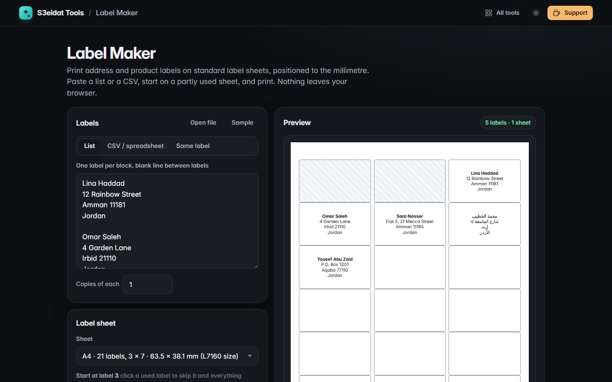

# Label Maker

> Print address and product labels on standard label sheets, positioned to the millimetre. Free, private, and it runs entirely in your browser.

### ▶ [Open Label Maker](https://s3eidat.github.io/label-maker/)



## Features

- **Sheet presets**: A4 with 21 (3 × 7), 24 (3 × 8), 14 (2 × 7), 40 (4 × 10) or 65 (5 × 13) labels; Letter with 30 (3 × 10), 10 (2 × 5) or 80 (4 × 20). The sizes match the common L7160 / L7159 / L7163 / L7654 / L7651 / 5160 / 5163 / 5167 sheets
- **Custom sheets**: columns, rows, label size, top/left margins and gaps, all in mm, with a warning if they run off the page
- **Three ways to fill them**: a list (one label per block, blank line between), a **CSV** or cells pasted from a spreadsheet (each row is a label, with an optional `{Name}` / `{1}` template), or the **same label repeated**
- **Copies of each** label, and **start on a partly used sheet** by clicking the first free label
- Font size and family, left / centre / right, top or middle, bold first line, optional border, padding, and **shrink long labels to fit**
- Arabic and other right-to-left lines are laid out right to left automatically
- **Exact printing**: every label is placed absolutely in mm on a page sized with `@page` (no margins), plus a **nudge** for printers that feed slightly off
- Live preview of every sheet

Print at 100% ("Actual size"). Test on plain paper first and hold it against a label sheet.

## Privacy

Your addresses never leave your device. Settings are remembered in this browser's local storage only.
There is no server, no account, no analytics. The page ships with a strict Content-Security-Policy
(`connect-src 'self'`), so the browser itself blocks any attempt to send data anywhere.

## Run it yourself

It's plain HTML, CSS and JavaScript with no build step:

```bash
git clone https://github.com/s3eidat/label-maker
cd label-maker
python -m http.server 8000
```

Then open http://localhost:8000.

## Support

If this saved you time, **[buy me a coffee ☕](https://s3eidat.github.io/coffee/)**. It keeps every tool free.

---

Part of **[S3eidat Tools](https://s3eidat.github.io/)**: 100+ free, private tools that run in your browser. MIT licensed.
